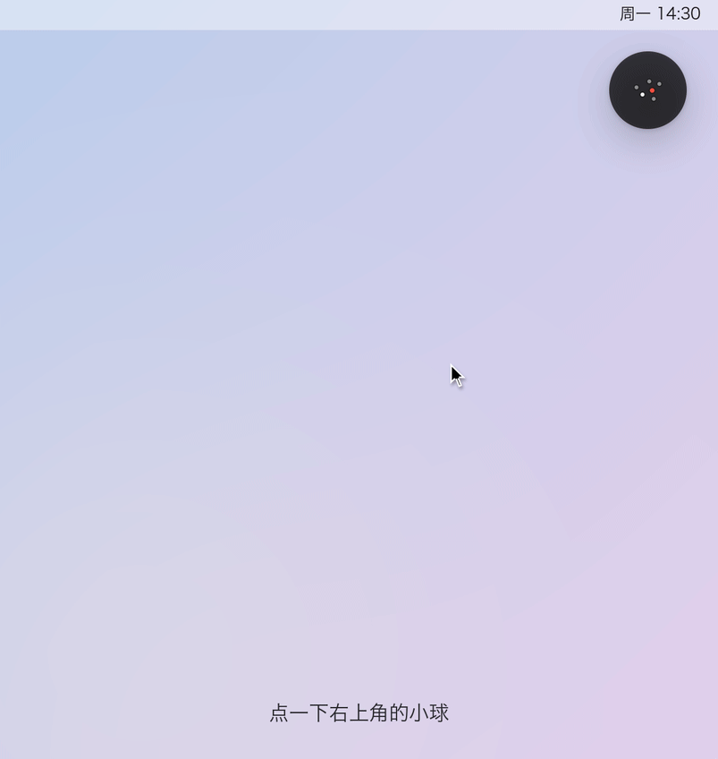
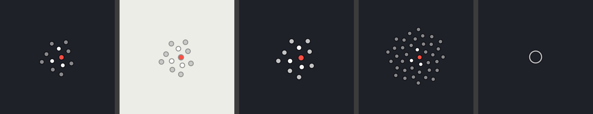

# Said

**Say it, and it's saved.**

A tiny orb that lives in the top-right corner of your Mac. When something pops into your head, click it, 
type or say one sentence, press Return — it lands in Apple Reminders and shows up on your iPhone.

[**Download**](https://github.com/Barca0412/said/releases/latest) · [Feedback](https://github.com/Barca0412/said/issues) · [中文](README.md)

 

The real Said interface with made-up to-dos. Captions and UI are in Chinese.

> **Heads-up:** the app's interface is currently **Chinese only**. Voice input handles mixed Chinese and English.

## Why

In the middle of a meeting or a document, a task suddenly comes to mind. Opening a to-do app, picking a list, creating an item, typing, setting a date — by then your focus is gone. Skip it, and you forget.

Said cuts capturing down to **one step**: the orb is always there; click, type or speak, Return. Everything else is plain Apple Reminders — iCloud sync, iPhone alerts, Siri, shared lists.

## What it does

One dot per open to-do: red is overdue, white is due today, grey is the rest. An empty orb shows a single small ring.

- **Always there, never in the way.** One dot per open task on the orb, red when overdue. Click outside and it rolls back into the orb — or keep it open, or let other windows cover it.
- **Dates in plain words.** "明天下午3点…" (tomorrow 3 pm) or "周五前…" (by Friday) sets the due date and keeps the title clean.
- **@who #which list.** Tag an owner with `@name`, pick a list with `#list` or the row of lists under the input.
- **Voice.** Words appear while you speak; fillers like "嗯、那个" are removed afterwards, with a word-by-word check that the result still comes from what you said. One click restores the original.
- **Everything, grouped by list.** Tick to complete, undo within seconds.
- **Share with a colleague.** Share a list in Reminders and you both see the same items in Said.
- **Your data stays yours.** Tasks live only in your own Reminders / iCloud. No server, no account.
- **One-click updates.** A red dot appears next to Settings; "更新" downloads, verifies the signature, replaces and relaunches.
- **Dark / light.**

## Install

Requires **macOS 14 (Sonoma) or later**, Apple silicon or Intel.

1. Download `Said-<version>.zip` from [Releases](https://github.com/Barca0412/said/releases/latest) and unzip it.
2. Drag **Said** into **Applications** and open it from there (updates can't replace an app running from Downloads).
3. macOS will block the first launch because Said is not notarized yet. Go to **System Settings → Privacy & Security**, scroll to **Security**, click **Open Anyway** next to "Said was blocked", and confirm. Only once.
4. Follow the 7-step setup guide.

Voice input uses Alibaba Cloud Model Studio (Qwen3-ASR + qwen-flash) with **your own API key** (Beijing or Singapore region). Typing works without it.

## Privacy

- Tasks stay in your own Reminders / iCloud. No analytics or tracking.
- Only when you use voice, the audio and the recognised text are sent to Alibaba Cloud Model Studio, together with your list and member names as hints.
- Your API key is stored in `~/Library/Application Support/WaveQuickCapture/keys.json`, readable only by your macOS user.
- Update checks only read `latest.json` from this repository's Releases.

## Source code

This repository hosts releases, the update manifest and issues. The source code is not public at the moment.

---

If Said saved you from forgetting something, a ⭐ helps others find it.

