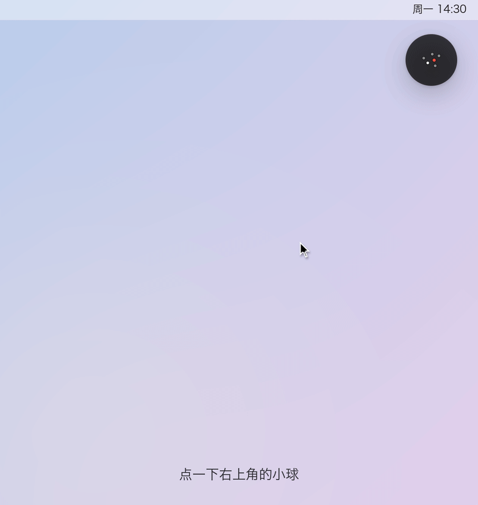
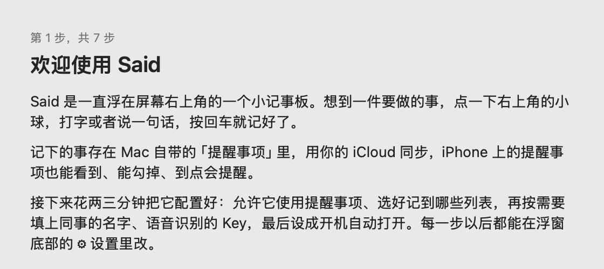
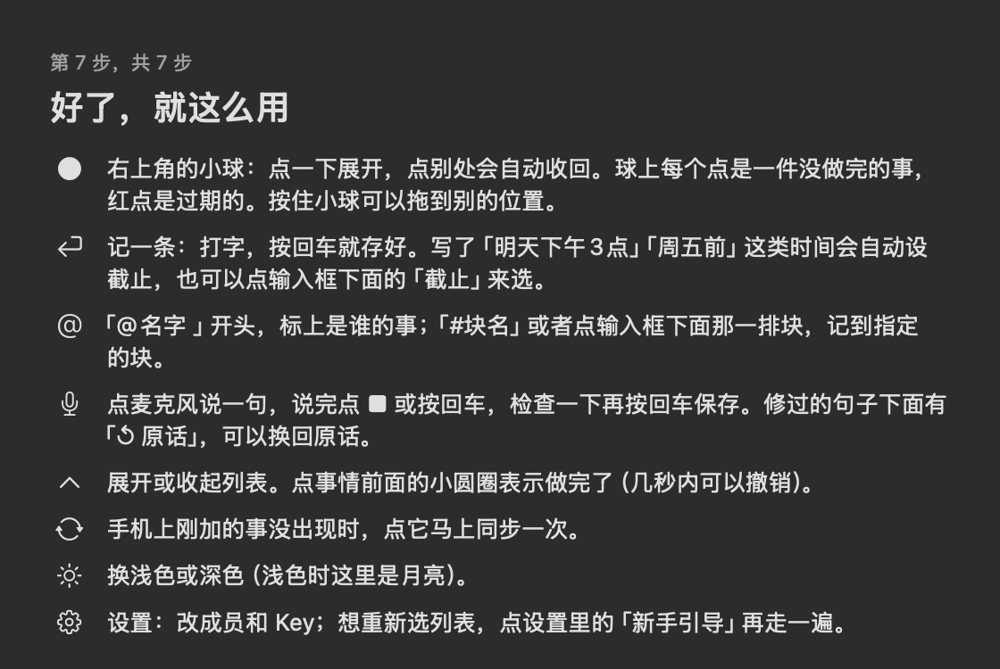

# Said

**说一句，就记下。**

一直浮在 Mac 屏幕右上角的待办小球。想到一件事，点一下，打字或说一句话，回车， 
它就存进了 Mac 自带的「提醒事项」，iPhone 上马上能看到、到点会提醒。

[**下载最新版**](https://github.com/Barca0412/said/releases/latest) · [怎么用](#怎么用) · [常见问题](#常见问题) · [反馈](https://github.com/Barca0412/said/issues) · [English](README.en.md)

 

Said 的真实界面，演示里的待办是虚构的。

---

## 为什么做 Said

开会、写东西、回消息的时候，脑子里会突然冒出一件事："下午要给张总回电话""周五前把合同发出去"。

这时候打开待办 App、找到列表、新建、输入、选日期，五六步下来，手上的事已经断了；不记吧，过一会儿就忘了。

Said 想把"记下来"这件事缩短到**一步**：小球一直在右上角，点它，说一句或打一句，回车。剩下的交给 Apple 自带的「提醒事项」：iCloud 同步、iPhone 提醒、Siri、共享列表，都是现成的。

## 它能做什么

小球上每个点是一件没做完的事：红点是过期的，白点是今天到期的，灰点是其他的。没有待办时只剩一个小圆圈。

| | |
| --- | --- |
| **一直在，但不挡事** | 右上角一个小球，球上每个点是一件没做完的事，红点是过期的。点开写完，点别处自动收回。也可以设成一直展开，或者不压在其他窗口上面。 |
| **一句话带上时间** | 写「明天下午3点给张总打电话」「周五前发合同」，截止时间自动设好，标题里不留时间词。 |
| **@谁 #哪个列表** | `@名字` 标上是谁的事，`#列表名` 或者点输入框下面那一排列表，记到指定的列表。 |
| **说话也行** | 点 🎤 说一句，字会边说边出来；说完自动去掉「嗯、那个」这类语气词。整理有逐字核对：结果必须基本都来自你的原话，不会替你加内容，不满意可以一键换回原话。 |
| **全部待办，按列表看** | 展开就是按列表分组的所有待办，点小圆圈打勾，几秒内可以撤销。 |
| **和同事一起用** | 在「提醒事项」里把列表共享给同事，两个人的 Said 里看到的是同一份。 |
| **数据在你自己手里** | 待办只存在你自己的「提醒事项」/ iCloud 里，Said 没有服务器，也不需要注册账号。 |
| **点一下就更新** | 有新版本时，设置按钮旁边出现一个小红点，点「更新」自动下载、校验签名、替换、重启。 |
| **深色 / 浅色** | 底部一个按钮切换。 |

 
第一次打开会有 7 步新手引导，跟着点就能配好。

## 安装

需要 **macOS 14（Sonoma）或更新**。Apple 芯片和 Intel 芯片的 Mac 都能用。

1. 到 [Releases](https://github.com/Barca0412/said/releases/latest) 下载 `Said-<版本>.zip`，双击解压。
2. 把 **Said** 拖进「应用程序」文件夹，**再从「应用程序」里打开**（从「下载」文件夹直接打开的话，以后没法在 App 里更新）。
3. 第一次打开会被系统拦下，说「无法验证开发者」。这是因为 Said 还没有做 Apple 公证，不是文件坏了。放行方法：
   打开「系统设置 → 隐私与安全性」，往下翻到「安全性」，点「已阻止 "Said"」旁边的 **「仍要打开」**，输入开机密码确认。只用做一次。
4. 跟着新手引导走：允许使用提醒事项 → 选要显示的列表 → （可选）填常一起做事的人 → （可选）语音 Key → 开机自动打开。

> 如果提示「已损坏，无法打开」：打开「终端」，运行 `xattr -dr com.apple.quarantine /Applications/Said.app`，再打开一次。

## 怎么用

- **记一条**：点小球 → 打字 → 回车。
- **带时间**：直接写在句子里，「今天下班前」「下周一上午10点」「周五前」都行；也可以点输入框下面的「截止」来选。
- **指定人和列表**：`@小王 明天交周报 #工作`。
- **语音**：点 🎤 说话，说完点 ■ 或按回车，看一眼，再按回车保存。
- **收起**：点别处会自动收回成小球；也可以点「–」，或者在输入框空着时按 `Esc`。
- **拖动**：按住小球拖到你喜欢的位置。

### 语音需要准备什么

语音识别用的是阿里云百炼的 Qwen3-ASR（实时识别）和 qwen-flash（去语气词）。你需要一个自己的**百炼 API Key**：

- 人在中国大陆：建「北京」地区的 Key；在海外：建「新加坡」地区的 Key。两个地区的 Key 不通用，两个都填的话 Said 会自动选更快的那个。
- 费用按百炼的用量计在你自己的账户上，记一句待办这种短句用量很小。
- 不用语音完全没关系，打字记事不受任何影响。

## 隐私

- 记下的事只存在你自己的「提醒事项」（你的 iCloud）里，Said 不会把它们发到别处，也没有任何统计或追踪。
- **只有用语音时**，录音和识别出的文字会发到阿里云百炼；为了把人名和列表名认对，你的列表名和成员名会一起作为参考发过去。
- 百炼 Key 保存在 `~/Library/Application Support/WaveQuickCapture/keys.json`，只有你自己的 macOS 用户能读。
- 检查更新时，Said 只会读取本仓库 Releases 里的一个版本清单 `latest.json`。

## 常见问题

<b>为什么第一次打开会被系统拦下？</b>

macOS 会拦下没有经过 Apple 公证的 App。Said 目前用的是开发者自己的签名证书，所以第一次需要你在「系统设置 → 隐私与安全性」里点一次「仍要打开」。之后的更新用的是同一张证书，系统会认出它是同一个 App，权限都会保留。

<b>更新安全吗？会不会被人换成别的程序？</b>

点「更新」后，Said 会先核对安装包的 sha256，再检查新版本的代码签名是否和你正在用的 Said 出自同一张证书。任何一项对不上都会拒绝安装并删掉下载的文件。替换前会备份当前版本，替换后签名校验失败会自动恢复。

<b>「检查更新」失败怎么办？</b>

更新放在 GitHub 上，有些网络访问 GitHub 很慢或不稳定，GitHub 自己偶尔也会超时。Said 会自动重试几次；还是失败的话，不影响正常使用，可以稍后再点「检查更新」，或者直接到 [Releases](https://github.com/Barca0412/said/releases/latest) 下载新版本替换。

<b>和直接用「提醒事项」App 有什么区别？</b>

数据完全一样，就是「提醒事项」。区别在于 Said 一直在屏幕上、一步就能记，还能用一句话带上时间、负责人和列表，或者直接说出来。整理和查看可以继续用「提醒事项」App 或 iPhone。

<b>支持英文界面吗？</b>

目前界面只有中文。语音识别本身支持中英文混说（比如「把 GitHub 的仓库权限改一下」）。

<b>源代码在哪里？</b>

这个仓库目前只放安装包、更新清单和问题反馈，源代码暂未公开。

## 接下来（计划，未承诺时间）

- 让模型帮忙判断一句话该进哪个列表、是谁的事、什么时候截止（现在靠规则）。
- Apple 公证：第一次打开不用再去系统设置里放行。

想要什么功能、遇到什么问题，欢迎在 [Issues](https://github.com/Barca0412/said/issues) 里说。

---

如果 Said 帮你少忘了一件事，点个 ⭐ Star，让更多人看到它。

